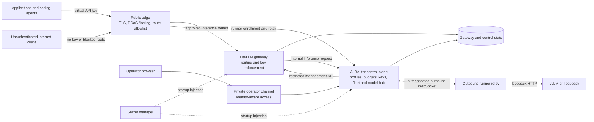

# Architecture

This repository documents the product topology without publishing a specific
operator's cloud account, region, machine names, tunnel identifiers, or private
administration path.

## Trust boundaries

- The public edge exposes inference, health, runner installation, enrollment,
  and authenticated runner relay routes only. Dashboard, control, and LiteLLM
  management routes are denied at the edge.
- LiteLLM validates a scoped virtual key before an inference request can spend
  money or reach a model. Keys can be restricted by profile, models, budget,
  RPM, and TPM.
- The AI Router dashboard is the single operator interface. LiteLLM's own UI is
  internal implementation detail and is not an operator entry point.
- The control plane uses a route-restricted LiteLLM management key. It cannot
  retrieve provider secrets or raw virtual keys.
- GPU runners initiate their connection outward. vLLM binds to loopback and is
  never directly exposed to the internet.

## What a public request receives

| Request | Result |
| --- | --- |
| Valid inference route and valid virtual key | Routed only to a model allowed for that key |
| Valid inference route without a key | `401 Unauthorized` |
| Invalid, revoked, exhausted, or disallowed key | Rejected before model execution |
| Dashboard, control, or LiteLLM management route | `404 Not Found` at the public edge |
| Unsupported path | `404 Not Found` |
| Excessive or abusive traffic | Subject to edge filtering and configured rate limits |

The health route intentionally reveals only that the service is available. It
does not return deployment coordinates or credentials.

## Secrets and public CI

The repository contains configuration shapes and safe examples only. Production
values are injected at runtime from a secret store. Deployment coordinates used
by CI are held as masked environment secrets, so the workflow source contains
no account, region, host, or identity-provider identifiers. CI logs must not
print secret values, `.env` files, tunnel credentials, provider keys, virtual
keys, or enrollment tokens.
